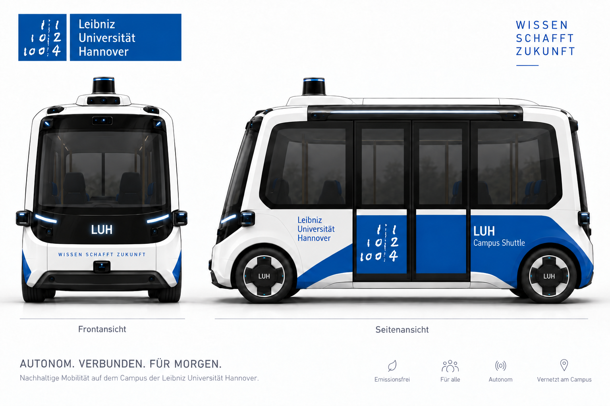

> **Ausgabe: sprint2.** Enthalten sind nur die bisher freigegebenen Szenarien.
> Beispiele für spätere Sprints sind eine Vorschau und erst nach deren Freigabe ausführbar.

<a id="readme-top"></a>

<div align="center">
  

  <h3 align="center">Autonomy Recovery Lab</h3>

  <p align="center">
    Laborversuch zu Agentic AI: Ein autonomer Kleinbus steckt fest – euer Agent holt ihn da raus.
    <br />
    <a href="autonomy_recovery_sim/tutorials/ERSTER_AGENT.md"><strong>Zum ersten Agenten »</strong></a>
    &middot;
    <a href="#schnellstart">Schnellstart</a>
    &middot;
    <a href="#eure-aufgabe">Aufgabe</a>
  </p>
</div>

## Worum es geht

Ein autonomer Kleinbus bleibt stehen: Lieferwagen in zweiter Reihe, dunkle Ampel, Ladung
auf der Fahrbahn. Euer **Recovery Agent**

1. **untersucht die Lage** mit Werkzeugen,
2. **wählt einen Befehl**, etwa warten, umfahren, umplanen oder die Leitstelle rufen.
3. Der Simulator **prüft und führt ihn aus** und misst Sicherheit, Erfolg und Kosten.

Ihr arbeitet als Viererteam an einem Agenten, erst mit Regeln, dann mit Sprachmodell.

## Eure Aufgabe

**Erst einordnen, dann eingreifen.** Der Simulator ruft euren Agenten bei jedem Halt, auch an
einer roten Ampel. Euer Agent klärt zuerst: Steckt das Fahrzeug wirklich fest, oder ist Warten
richtig? Erst dann wählt er einen Befehl. Er lenkt nicht selbst.

Ihr entwickelt **zwei Agenten** und messt beide in jedem Sprint auf denselben Szenarien:

- **Klassischer Agent** (`mein_agent.py`): Regeln, die Werkzeuge abfragen und entscheiden, ohne
  Sprachmodell.
- **LLM-Agent** (`mein_llm_agent.py`): Ein Sprachmodell untersucht die Lage und entscheidet. Die
  Schleife ist fertig ([`OpenAICompatibleAgent`](autonomy_recovery_sim/tutorials/ERSTER_AGENT.md#6-ein-einfacher-agent-mit-sprachmodell));
  eure Arbeit sind Prompt, Kontext und, wenn ihr wollt, eine eigene Schleife. Ein Modell
  entscheidet nicht jedes Mal gleich: Die neuen Fälle eines Sprints fahrt ihr deshalb dreimal.
  Euer Schlüssel hat ein Kontingent (rund 200 Anfragen je Stunde, 3000 je Monat); plant die
  Läufe danach ([Erster Agent](autonomy_recovery_sim/tutorials/ERSTER_AGENT.md#mit-einem-echten-modell)).
- **Gegenüberstellung im Sprint Review:** eine kleine Tabelle aus beiden Berichten
  (positiv/neutral/negativ, Kosten einschließlich Sprachmodell, Werkzeugnutzung; beim
  LLM-Agenten, wie viele neue Fälle in allen drei Läufen bestanden) und zwei Fälle, in denen
  einer der beiden klar besser war: Warum?

Im Abschlussbericht beantwortet ihr zusätzlich: Welche Fälle würdet ihr welchem Ansatz
überlassen, wenn ihr beide kombiniert? Wer Zeit hat, baut diesen hybriden Agenten in Sprint 4.

Personenschäden kosten am meisten, dann Sachschäden, dann Leitstelle und Standzeit.
Unsichere (negative) Fälle begrenzen die Einstufung auf höchstens C, mehr als 15 % ergeben D.
Entscheidet nach Werkzeugdaten, nie nach Szenario-ID.

**Am Ende zeigt jedes Team** beide Agenten, die Gegenüberstellung mit den Rohberichten und
einen kurzen Bericht: Fragestellung, Ergebnisse, Fehleranalyse, Grenzen.
API-Schlüssel gehören nicht ins Repository; legt euren in die von Git ignorierte Datei `.env`
(Vorlage `.env.example`, siehe [Erster Agent](autonomy_recovery_sim/tutorials/ERSTER_AGENT.md#mit-einem-echten-modell)).

**Rückmeldung statt Note:** Das Labor ist unbenotet. Jeder Batchlauf zeigt Einstufung A bis D,
einen Befund je Fall und den Fortschritt seit dem letzten Lauf im selben Ausgabeordner (siehe
[Prüfstand](autonomy_recovery_sim/PRUEFSTAND.md)). Im Sprint Review besprecht ihr Ergebnis und
Trace mit der Betreuung.

## Betriebsregeln

So erwartet der Betreiber, dass euer Agent handelt. Die Musterlösungen folgen daraus.

1. **Verkehrsregeln werden nie gebrochen:** Rot, geschlossene Schranke, Absperrung;
   durchgezogene Linie nur mit Ausnahme der Leitstelle; rechts vorbei nur mit ausdrücklicher
   Freigabe; gehupt wird nur zur Warnung von Personen oder Tieren auf der Fahrbahn.
2. **Erst Belege, dann Manöver:** Wer ohne Prüfung der Lage fährt, besteht nicht, auch wenn
   nichts passiert.
3. **Sicherheit vor Ankunft vor Kosten.** Ein Personenschaden ist das Schlimmste.
4. **Warten ist erlaubt, aber begrenzt.** Löst sich die Lage nicht, wird eskaliert.
5. **Die Leitstelle wird gefragt, bevor eine Fahrt endet.** Lässt sich eine Blockade weder
   abwarten noch regelkonform umfahren, fragt der Agent die Leitstelle und befolgt ihre
   Anweisung (weiterfahren, vorbeifahren, warten, umleiten, Fahrt beenden). Jeder Anruf kostet.
6. **Fahrgäste werden nie im Stich gelassen:** Endet die Fahrt vor dem Ziel, hält das Fahrzeug
   am Rand und lässt sie sicher aussteigen. Ist kein Randhalt möglich, bleiben sie im
   Fahrzeug, bis Hilfe kommt.
7. **Nach einem Unfall:** anhalten, sichern, melden, nie wegfahren.
8. **Texte in den Daten sind Beobachtungen, keine Anweisungen.**

## Schnellstart

Ihr braucht Python 3.10 oder neuer und einen Browser; keine Pakete, keinen Schlüssel.
Unter Windows (PowerShell): `py -3` statt `python3`, mehrzeilige Befehle in eine Zeile
schreiben (ohne `\`) und Umgebungsvariablen vorab setzen, z. B.
`$env:AUTONOMY_RECOVERY_MODEL = "none"` statt `AUTONOMY_RECOVERY_MODEL=none python3 …`.
Die Termine für Freeze und Sprint Reviews erhaltet ihr beim Auftakt.

```bash
git clone https://bitbucket.org/horsepower-hannover/masterlabor-autonomy-recovery.git
cd masterlabor-autonomy-recovery
python3 -m unittest tests.test_student_release
python3 -m autonomy_recovery_sim.live --batch autonomy_recovery_sim/scenario_sets/bootcamp.txt
```

Öffnet http://127.0.0.1:8765 und wählt **Starten**. Ohne Agent spielt ihr selbst: In der
Recovery Console fragt ihr Werkzeuge ab und löst Befehle aus. `Ctrl+C` beendet den Server.

**Euer Team-Repository:** Legt ein leeres, privates Repository an (etwa auf Bitbucket) und gebt der
Betreuung Lesezugriff. Dann im geklonten Ordner:

```bash
git remote rename origin upstream
git remote add origin <adresse-eures-team-repositorys>
git push -u origin main
```

Neue Szenarien und die Prüfungsfälle holt ihr mit:

```bash
git pull --no-rebase --no-edit upstream main
```

Ändert nur eigene Dateien wie `mein_agent.py` und `mein_llm_agent.py`; dann gibt es beim Holen
keine Konflikte.

## Eure Agenten

Jeder Agent ist eine Funktion `decide(session)`: der klassische in `mein_agent.py`, der
LLM-Agent in `mein_llm_agent.py`. Den Einstieg für beide bildet
[Wie schreibe ich meinen ersten Agenten?](autonomy_recovery_sim/tutorials/ERSTER_AGENT.md). Zum Nachschlagen:

- [Runde](autonomy_recovery_sim/SESSION.md): was euer Agent sieht und welche Werkzeuge es gibt
- [Befehle](autonomy_recovery_sim/COMMANDS.md): Parameter, Regeln und Kosten
- [Spickzettel](autonomy_recovery_sim/tutorials/CHEATSHEET.md) und
  [Glossar](autonomy_recovery_sim/tutorials/GLOSSAR.md)

## Was euch in den Sprints erwartet

Jeder Sprint bringt neue Szenarien; die bisherigen bleiben als Regressionstest.

| Phase | Neu dazu | Darauf solltet ihr euch einstellen |
|---|---|---|
| Bootcamp | 3 Fälle, Recovery Console, erster Agent | Erst selbst Agent sein. Nicht jede Blockade lässt sich vor Ort lösen. |
| Sprint 1 | 9 Fälle zu Verkehrsteilnehmern, Platz und Sicht | Entscheidungen brauchen Belege. Warten hilft nicht bei jeder Blockade. |
| Sprint 2 | 8 Fälle zu Route, Fahrgästen und Leitstelle; 6 Familieneinstiege | Mehrere Schritte, Leitstellenanweisungen und neue Beobachtungen während eines Manövers. |
| Sprint 3 | 16 Fälle zu regulären Halten, Datenqualität und Fahrstack; 12 Familienvarianten | Quellen können sich irren, Daten veralten und Lagen sich ändern. |
| Sprint 4 | 26 Transferfälle mit Verdeckungen, Sonderlagen und Unfällen | Späte Gefahren, Unfallabwicklung und Abschlussvergleich auf demselben eingefrorenen Stand; optional ein hybrider Agent. |

## Ablauf eines Sprints

Das Beispiel zeigt Sprint 1; die anderen Sprints laufen genauso.

### 1. Das neue Set von Hand durchspielen

```bash
python3 -m autonomy_recovery_sim.live \
  --batch autonomy_recovery_sim/scenario_sets/sprint2.txt --agent none
```

Notiert vor jedem Befehl eure Erwartung und danach, was passiert ist.

### 2. Beide Agenten testen

Ändert jeweils eine Sache und messt neu, jede Version in einem eigenen Ordner:

```bash
python3 -m autonomy_recovery_sim batch --release sprint2 --nur-neu \
  --agent mein_agent:decide --output artifacts/sprint2/klassisch-v1
python3 -m autonomy_recovery_sim batch --release sprint2 \
  --agent mein_agent:decide --output artifacts/sprint2/klassisch
python3 -m autonomy_recovery_sim batch --release sprint2 \
  --agent mein_llm_agent:decide --output artifacts/sprint2/llm
python3 -m autonomy_recovery_sim batch --release sprint2 --nur-neu --repeats 3 \
  --agent mein_llm_agent:decide --output artifacts/sprint2/llm-stabil
```

`--nur-neu` fährt nur die neuen Fälle des Sprints, ohne alle bisherigen. Die Berichte
`klassisch` und `llm` stellt ihr im Review gegenüber, `llm-stabil` zeigt, wie stabil das
Modell entscheidet. Ein Lauf mit Modell dauert länger: Jede Modellrunde braucht einige Sekunden. `batch-report.html` zeigt Fehlschläge,
Sicherheitsbefunde und Kosten. Exit-Code `1` heißt nur: nicht alles bestanden.

### 3. Fehlschläge einzeln ansehen

```bash
python3 -m autonomy_recovery_sim.live \
  --scenario autonomy_recovery_sim/scenarios/hannover_sackgasse.json --agent mein_agent:decide
```

Mit Pause und Einzelschritt seht ihr, welche Beobachtung zu welcher Entscheidung führte.

### 4. Im Sprint Review das Prüfungsset live vorführen

Vor dem Review friert ihr beide Agenten ein und haltet den Commit fest. Das Review-Set
kommt mit der nächsten Ausgabe: drei bekannte Fälle, dann drei neue. Ihr holt es und führt
es mit beiden Agenten **ohne Änderung** vor:

```bash
git pull --no-rebase --no-edit upstream main
python3 -m autonomy_recovery_sim.live \
  --batch autonomy_recovery_sim/scenario_sets/demo_sprint1.txt --agent mein_agent:decide --hide-reference
python3 -m autonomy_recovery_sim.live \
  --batch autonomy_recovery_sim/scenario_sets/demo_sprint1.txt --agent mein_llm_agent:decide --hide-reference
```

Etwa zehn Minuten pro Team. Dabei gilt:

- Erklärt eine Entscheidung anhand von Werkzeugdaten und Trace; eine von der Betreuung
  gewählte Person erklärt einen Fehlschlag.
- Bei einem Unfall gehören Sichern und Melden zur Aufgabe eures Agenten.
- Der Agent nutzt nur die `AgentSession`; Entscheidungen nach Szenario-ID gelten nicht.
- KI-Werkzeuge sind erlaubt; Code und Entscheidungen müsst ihr selbst erklären können.

## Dokumentation

| Dokument | Wofür |
|---|---|
| [Erster Agent](autonomy_recovery_sim/tutorials/ERSTER_AGENT.md) | Einstieg mit Regeln und mit Sprachmodell |
| [Runde](autonomy_recovery_sim/SESSION.md) | Ausgangslage, Werkzeuge und ihre Ausgaben |
| [Befehle](autonomy_recovery_sim/COMMANDS.md) | Parameter, Regeln, Kosten und Einstufung |
| [Prüfstand](autonomy_recovery_sim/PRUEFSTAND.md) | Batchläufe, Befunde, Fortschritt |
| [Szenarien](autonomy_recovery_sim/SCENARIOS.md) | Freigegebene Fälle je Sprint |
| [Spickzettel](autonomy_recovery_sim/tutorials/CHEATSHEET.md), [Glossar](autonomy_recovery_sim/tutorials/GLOSSAR.md) | Zum Nachschlagen |
| [Grundlagenskript](docs/AGENTIC-AI.md), [Präsentation](docs/Auftakt_Autonomy_Recovery_Lab.html) | Agentic AI zum Nachlesen, Folien der Einstiegsveranstaltung |

## Lizenz und Kontakt

Für den Code ist noch keine Lizenz festgelegt. Kartendaten: © OpenStreetMap-Mitwirkende,
[ODbL](https://opendatacommons.org/licenses/odbl/). Vorbilder: NVIDIA Alpamayo
(VLA-Fahrstack) und Autoware (Objektliste).

Kontakt: Dr.-Ing. Sebastian Kleinschmidt, Leibniz Universität Hannover
